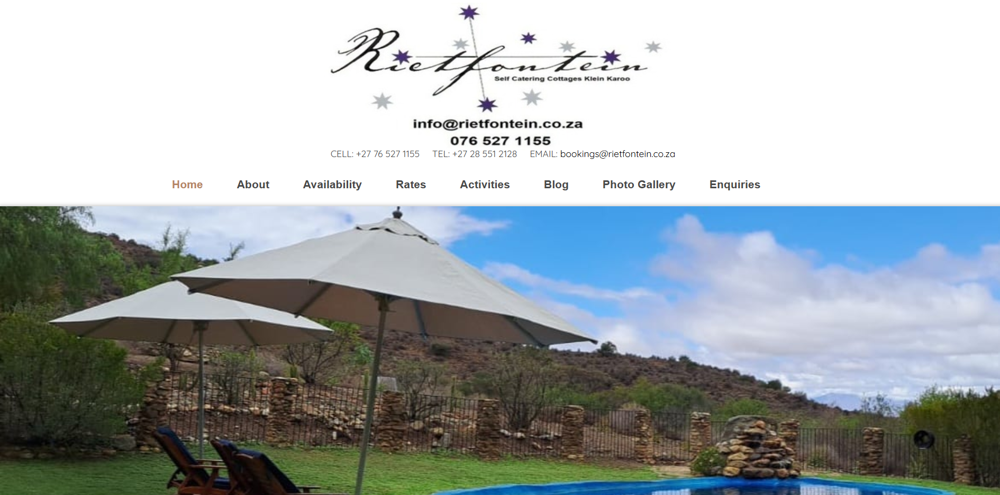
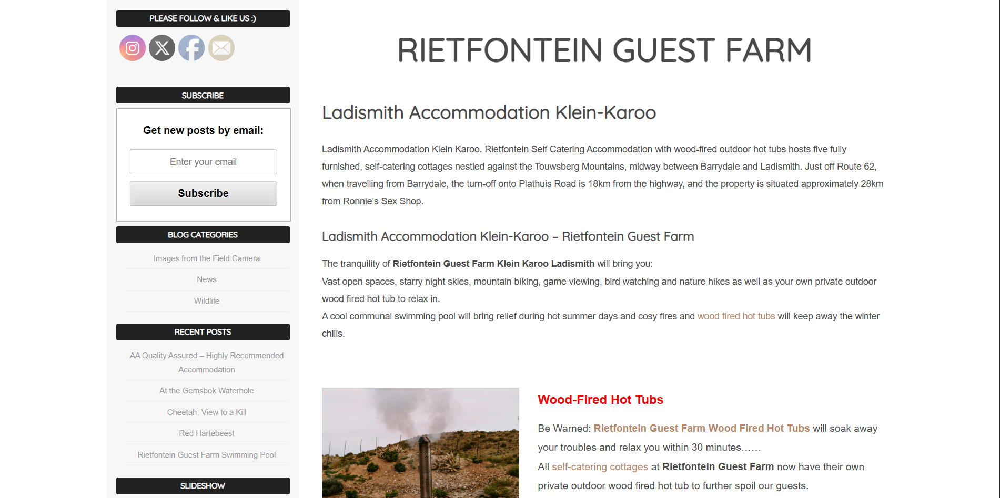
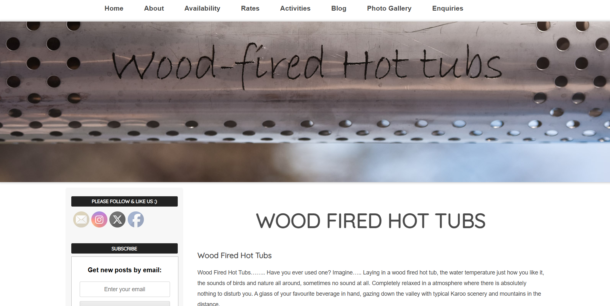
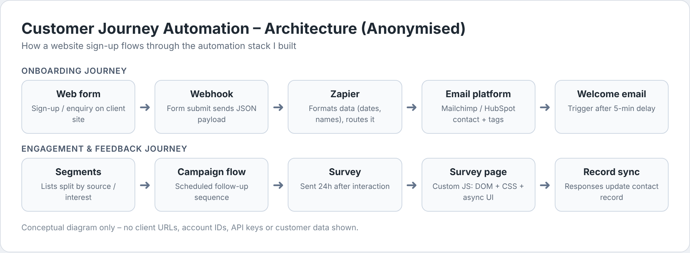
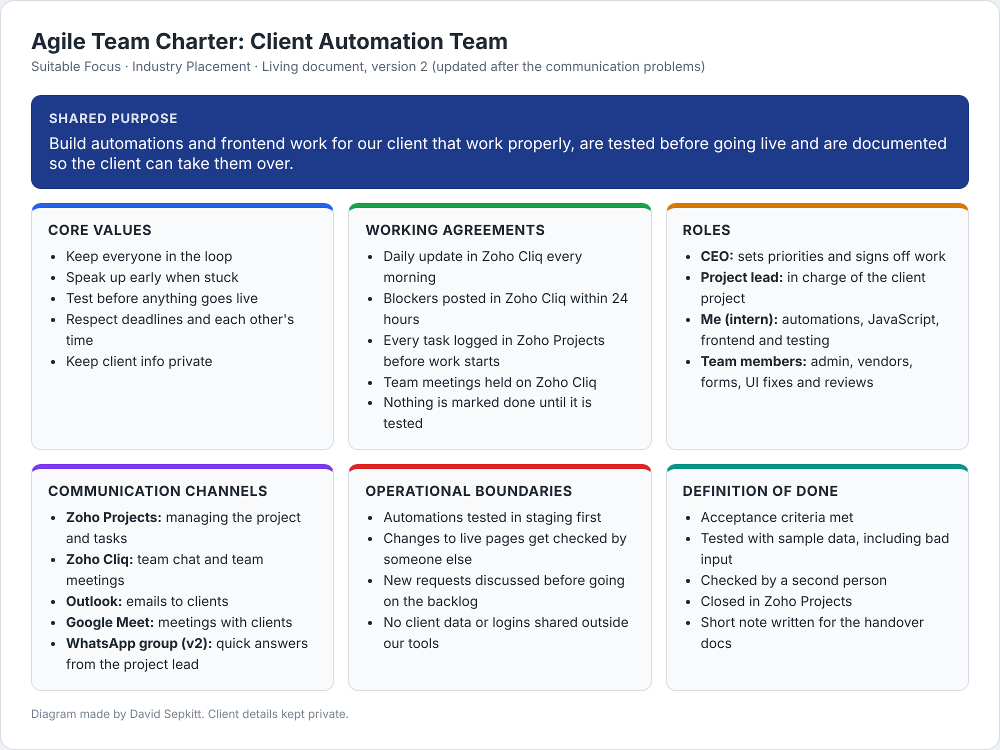
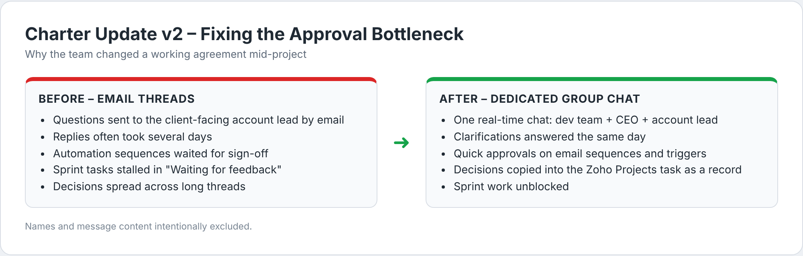
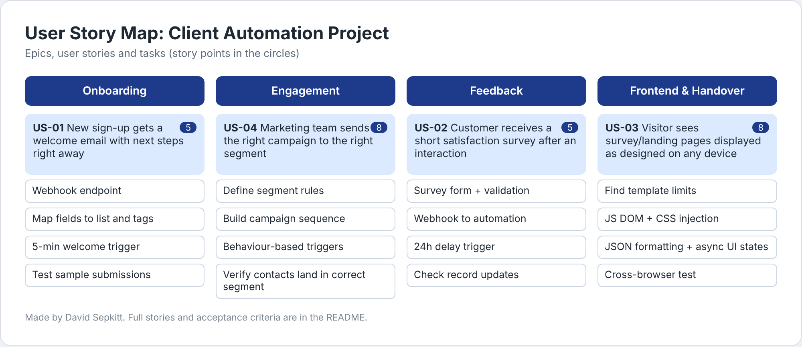
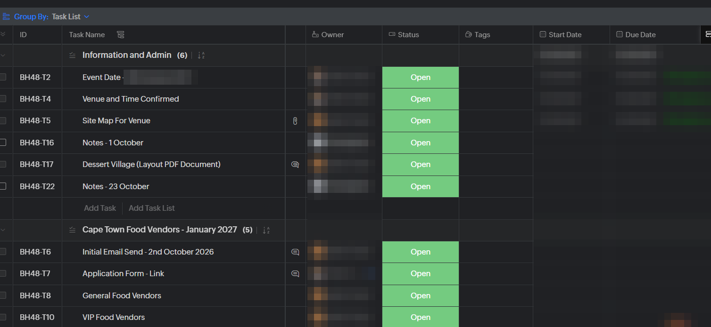
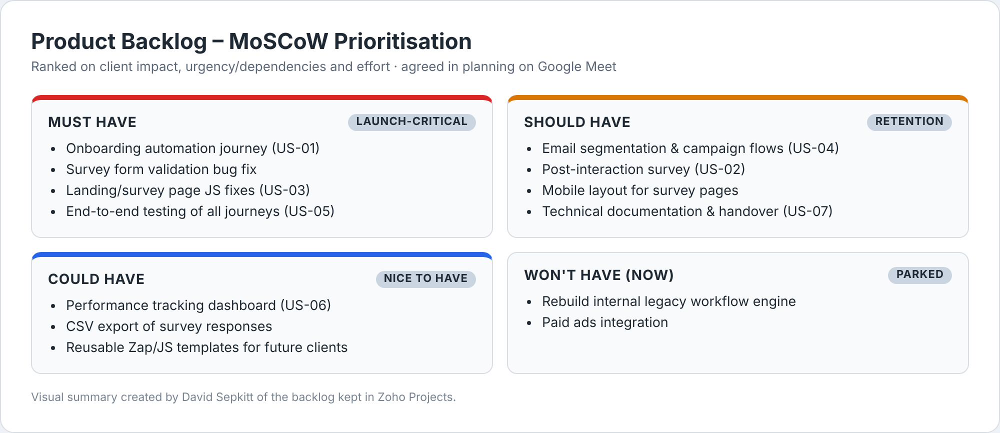
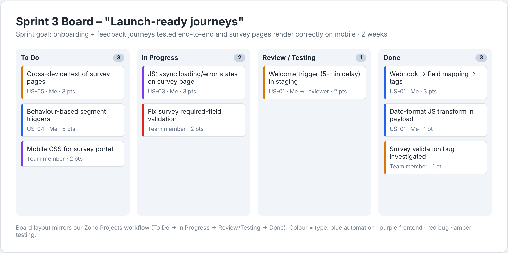

# David Daniel Sepkitt Professional Portfolio

**Diploma in ICT: Applications Development at the Cape Peninsula University of Technology (CPUT)**

**PRP370S Project Presentation 3: Digital Portfolio of Evidence for Semester 1 and Semester 2**

| | |
|---|---|
| **Email** | 240046935@mycput.ac.za |
| **Location** | Cape Town, South Africa |
| **GitHub** | [github.com/DavidDanielx72](https://github.com/DavidDanielx72) |
| **LinkedIn** | [linkedin.com/in/david-sepkitt-811837362](https://www.linkedin.com/in/david-sepkitt-811837362/) |
| **Live Portfolio** | [daviddanielx72.github.io](https://daviddanielx72.github.io/) |

---

## Table of Contents

1. [Career Objective](#career-objective)
2. [Education](#education)
3. [Work Experience](#work-experience)
4. [Technical Skills](#technical-skills)
5. [Semester 1: Foundational Projects and Career Readiness](#semester-1-foundational-projects-and-career-readiness)
6. [Semester 2: Industry Placement Agile Portfolio](#semester-2-industry-placement-agile-portfolio)
    * [How We Work at Suitable Focus](#how-we-work-at-suitable-focus)
    * [1. Agile Team Charter](#1-agile-team-charter)
    * [2. User Stories and Tasks](#2-user-stories-and-tasks)
    * [3. Product Backlog](#3-product-backlog)
    * [4. Sprint Backlog](#4-sprint-backlog)
    * [5. Agile Logbook](#5-agile-logbook)
    * [Summary](#summary)
7. [Links](#links)

---

## Career Objective

I am a third year student at CPUT studying towards a Diploma in ICT in Applications Development. I am currently completing my Industry Placement at **Suitable Focus** where I work on automations, web development and frontend work for the company's clients.

I have a solid foundation in Java, JavaScript, HTML, CSS and SQL. During my placement I've gained practical experience in workflow automation and email marketing as well as syncing data between platforms. This includes making use of tools such as Zapier, Mailchimp, HubSpot, webhooks and my own JavaScript. My goal is to become a Full Stack Developer who understands both the development side and the business side of the solutions I build.

---

## Education

| Institution | Qualification | Period |
|---|---|---|
| Cape Peninsula University of Technology (CPUT) | Diploma in ICT: Applications Development | 2024 to present |
| Zwaanswyk High School | National Senior Certificate | 2019 to 2023 |

---

## Work Experience

### Automation and Web Development Intern at Suitable Focus
*Current Industry Placement*

Suitable Focus is a recently established agency. As the company is still growing there was no formal project management system in place from the start. As the client work increased the team adopted an Agile way of working and started making use of Zoho Projects to stay organised. My main project at the moment is building the automation side for one of our clients from the ground up. The client's name has been kept private in this portfolio.

**My responsibilities include:**
* Building automated customer journeys for onboarding and follow ups
* Setting up email triggers, list segments and scheduled campaigns in Mailchimp and HubSpot
* Setting up automated customer surveys and feedback
* Connecting web forms to the automation platforms by making use of webhooks, APIs and Zapier
* Writing JavaScript to fix layouts, format data and handle loading states where the website template could not do what was needed
* Logging my tasks in Zoho Projects and giving daily updates to the team on Zoho Cliq

### Rietfontein Ladismith Guest Farm Website Update
*January 2026 (3 weeks)*
* Updated the website content which had not been updated since 2016
* Improved the mobile experience of the website
* Added new images, updated the content and improved the layout
* Website: [rietfontein.co.za](https://rietfontein.co.za/)

### Country Road Waterfront (Woolworths Group)
*Seasonal Sales Consultant from December 2025 to January 2026*
* Assisted customers in the menswear department
* Handled stock replenishment and checked deliveries

### Cape Town DHL Stadium
*Casual Bar Attendant and Cashier from December 2023 to February 2024*
* Served customers during busy events and concerts
* Completed the cash up at the end of each shift

---

## Technical Skills

| Area | Skills |
|---|---|
| **Languages** | Java, JavaScript, HTML, CSS and SQL |
| **Frameworks and Platforms** | React, Supabase, WordPress and Java Swing |
| **Automation and Integration** | Zapier, Mailchimp, HubSpot, webhooks, REST APIs and JSON |
| **Agile and Project Management** | Zoho Projects, Scrum, Kanban, user stories, MoSCoW, sprint planning and retrospectives |
| **Communication Tools** | Zoho Cliq, Outlook and Google Meet |
| **Tools and IDEs** | Git, GitHub, GitHub Pages, IntelliJ IDEA, NetBeans and Visual Studio Code |
| **Other** | OOP, layered architecture, debugging and testing, Markdown and DOM manipulation |

---
---

# Semester 1: Foundational Projects and Career Readiness

## Projects

### 1. Rietfontein Guest Farm Website Update (Real Client)
*January 2026, individual project*

Website: [rietfontein.co.za](https://rietfontein.co.za/)

I updated the frontend of a real guest farm website based on the owner's requirements. The website runs on WordPress and the content was last updated in 2016. My task was to bring the website up to date and improve how it works on mobile devices.

**My role:**
* Went through the changes the client wanted
* Customised the WordPress theme and improved the layout
* Updated the text, images and page structure of pages such as the home page, hot tubs page and activities page
* Improved the mobile experience
* Tested the pages on different screen sizes before handing the website over

**Technologies:** WordPress, HTML and CSS

**Screenshots:**

<table>
  <tr>
    <td align="center"><br/><sub>Updated home page header and menu</sub></td>
    <td align="center"><br/><sub>Updated content page</sub></td>
  </tr>
  <tr>
    <td colspan="2" align="center"><br/><sub>Hot tubs page with the new banner</sub></td>
  </tr>
</table>

---

### 2. Catering Business Website (Group Project for a Real Client)
*2026 to present*
* Full stack website for a real catering client
* The frontend is built in React and the backend and database make use of Supabase
* We work as a team on the design, the components and the database
* The code is shared and managed on GitHub

---

### 3. Student Community App
*2025, built in Java with NetBeans*
* A Java application made for students
* Includes notifications, a marketplace and a chat feature
* Built with Java Swing and OOP principles

---

### 4. Payroll Application
Repository: [github.com/DavidDanielx72/PayrollApplication](https://github.com/DavidDanielx72/PayrollApplication)

A Java payroll system for a company called STARTUP which has over 2000 employees. The purpose of the system is to replace the company's manual payroll process and provide HR with better information.

**The system stores:**
* Employee details such as the employee number, name, employment type and nationality
* Contact and address details
* Identity types such as a passport
* Job positions as well as whether a position is OPEN or CLOSED

**Structure:** The system makes use of a presentation layer, a service layer and a repository layer.

**Technologies:** Java, OOP and IntelliJ IDEA

---

### 5. Wholesale Management System (Group Project)
Repository: [github.com/DavidDanielx72/ADP_Assignment-02](https://github.com/DavidDanielx72/ADP_Assignment-02)

A backend Java system that helps small wholesale stores manage their daily operations.

**My role:**
* Wrote the `Customer` class
* Made sure the package structure was correct across the project
* Added the test classes that were missing
* Helped with debugging and getting the whole team's code to run together

**Technologies:** Java, OOP, IntelliJ IDEA and GitHub

---

### 6. GitHub CV and Portfolio Website
Website: [daviddanielx72.github.io](https://daviddanielx72.github.io/)

* My CV and portfolio hosted on GitHub Pages
* It started as an HTML, CSS and JavaScript website and I later moved it to Markdown so that it is easier to keep updated
* It includes my CV, projects, mock interview and reflections

**Technologies:** HTML, CSS, JavaScript, Markdown and GitHub Pages

---

## Mock Interview

As part of the work readiness training I completed a mock interview which was recorded.

**[Watch my mock interview on YouTube](https://www.youtube.com/watch?v=ZQn11TBY3bs)**

---

## Semester 1 STAR Method Reflections

### Markdown Coding Reflection

**Situation:** I was required to build my GitHub portfolio using Markdown for my assessment.

**Task:** I needed to present my work, projects and reflections in a clear and professional way.

**Action:** I learnt how to make use of headings, links, lists, tables and images in Markdown. I kept the same structure throughout the portfolio and added a table of contents so that it is easy to find each section.

**Result:** My portfolio is easy to read and navigate. I now make use of the same structure at work when I write notes and documentation.

---

### Mock Interview Reflection

**Situation:** I took part in a mock interview as part of the work readiness training.

**Task:** I had to answer the interview questions in a professional and confident way.

**Action:** I practised common interview questions using the STAR method and chose real project examples to speak about such as my Payroll Application and the Rietfontein website. I also recorded myself so that I could review my body language and how fast I was speaking.

**Result:** I felt a lot more confident afterwards and I improved at explaining technical work in simple terms. This helped me when I had my interview for my Industry Placement.

---

### GitHub Pages Reflection

**Situation:** I needed to publish my portfolio online so that lecturers and employers could view it.

**Task:** I had to publish the portfolio using GitHub Pages.

**Action:** I set up the repository and enabled GitHub Pages from the main branch. After every change I tested all of the links and image paths.

**Result:** My portfolio is live and I understand how static hosting works. I continue to update it and this semester I added my Agile work from my Industry Placement.

---
---

# Semester 2: Industry Placement Agile Portfolio

This section covers my Industry Placement at Suitable Focus. Each part includes my **Evidence** followed by my **Reflection** which I wrote using the Collect, Select, Reflect and Connect approach.

## How We Work at Suitable Focus

Suitable Focus did not have a formal project management setup when the company started. As the client work increased the team started working in an Agile way. This includes working in sprints, keeping a backlog, giving daily updates and holding retrospectives. We also started making use of the following tools to stay organised.

| Tool | What we make use of it for |
|---|---|
| **Zoho Projects** | Managing our projects. All tasks, task lists, owners and statuses are kept here. This is the only tool we make use of for project management. |
| **Zoho Cliq** | Team communication. This includes daily updates, quick questions, blockers and our team meetings. |
| **Outlook** | Sending emails to our clients. |
| **Google Meet** | Meetings with our clients. |
| **WhatsApp group** | Created during the project as communication with the team member in charge of the client project was slow. This is explained further in the Team Charter section. |

**A note on Trello:** The assessment brief makes use of Trello as an example. We do not make use of Trello at Suitable Focus. We only recently started using Zoho Projects which offers task lists, a board view and statuses. All of my evidence therefore comes from Zoho Projects.

### The Client Project

My current project is for a new client of Suitable Focus. I have kept the client's name and details private. We are building their automation setup from the ground up. The goal is to automate how the client onboards and follows up with people as well as to connect their web forms and surveys to their email marketing platform.


*Figure 1: The automations I built step by step (diagram made by me).*

**Where the project currently stands:**

| Completed | Still to be completed |
|---|---|
| Planned and set up the main automated journeys | More detailed segments based on how people interact with the emails |
| Email triggers, segments and campaigns | Dashboards to track how the emails and surveys perform |
| JavaScript for the survey pages such as the layout, CSS, JSON formatting and loading states | Full testing from start to end on different devices and form inputs |
| Web forms connected to the automation platform | Writing the documentation and handing the project over to the client through Zoho Projects |

### Keeping Client Information Private

As this portfolio is public I have left out the following:
* The client's name, website links and the names of the people involved
* Any customer data, email addresses, API keys, account IDs or logins
* Any information about pricing or contracts
* The names and profile pictures in my Zoho Projects screenshot have been blurred

The diagrams marked "made by me" are my own illustrations of how we work. I made use of them where a real screenshot would show private information.

---

## 1. Agile Team Charter

### Evidence

As Suitable Focus is a startup there was no existing team charter. The team agreed on how we would work at the start of the project and we then updated it during the project when we experienced a communication problem. Below is the current version (version 2).


*Figure 2: Our team charter for the client project (diagram made by me based on what the team agreed on).*

**Summary of the charter:**

| Part | What we agreed on |
|---|---|
| **Shared purpose** | Build automations and frontend work for our client that work properly, are tested before going live and are documented so that the client can take them over. |
| **Core values** | Keep everyone informed, speak up early when stuck, test before anything goes live, respect deadlines and each other's time as well as keep client information private. |
| **Roles** | The CEO sets priorities and signs off work. The project lead is in charge of the client project. I am responsible for the automations, JavaScript, frontend and testing. Other team members handle the admin, vendors, forms, UI fixes and reviews. |
| **Working agreements** | A daily update in Zoho Cliq every morning. Blockers are posted in Zoho Cliq within 24 hours. Every task is logged in Zoho Projects before work starts. Team meetings are held on Zoho Cliq. |
| **Communication** | Zoho Projects for managing the project, Zoho Cliq for the team, Outlook for client emails and Google Meet for client meetings. |
| **Boundaries** | Automations are tested in staging first. Changes to live pages are checked by another team member. New requests are discussed before they are added to the backlog. No client data or logins are shared outside of our tools. |
| **Definition of Done** | The acceptance criteria are met, the work is tested with sample data including incorrect input, it is checked by a second person, it is closed in Zoho Projects and a short note is written for the handover. |

#### Changes to the charter

| Version | What happened | What we changed |
|---|---|---|
| Version 1 (start of the project) | Starting the project | We agreed on our tools, daily updates, testing in staging first and our Definition of Done |
| Version 2 (Sprint 2) | The team member in charge of the client project took a long time to reply to emails which caused our tasks to get stuck while waiting for answers | We created a WhatsApp group with the dev team, the CEO and the project lead so that we could get answers quickly. We also agreed that any decision made in the group gets copied into the task on Zoho Projects so that we still have a record of it |


*Figure 3: How communication worked before and after we created the WhatsApp group.*

### Reflection

**Collect:**
During my first few weeks I paid attention to how the team worked and where things slowed down. I noticed that some tasks were only discussed and never written down which caused them to get lost. Later in the project I noticed that we were waiting days for replies to emails from the person in charge of the project. I picked this up from my own tasks being stuck as well as from our daily updates and team meetings on Zoho Cliq.

**Select:**
The agreements that made the biggest difference were logging every task in Zoho Projects and posting blockers in Zoho Cliq straight away. The main piece of evidence I want to highlight is the version 2 change with the WhatsApp group. This shows that our charter was used to solve a real problem and was not only written once and forgotten about.

**Reflect:**
The communication problem taught me that work can be fully built and ready but it cannot move forward without an answer. Our automations were ready to go live but they needed to be signed off first. Once we had the WhatsApp group the questions that used to take days were answered within a few hours. I also noticed the downside of WhatsApp which is that decisions can get lost between messages. This is why copying decisions into Zoho Projects was important. Personally I learnt to raise a blocker early instead of waiting and to keep my questions short and specific so that they are easy to answer.

**Connect:**
The charter ties into every other part of this portfolio. I make use of the Definition of Done for the acceptance criteria in my user stories. The rule about discussing new requests controls what gets added to the product backlog. My logbook is built from our daily updates and the version 2 change came from a sprint retrospective. Looking back at my Semester 1 group projects we never agreed on how we would work and this caused confusion. The next time I work in a team I would start by creating a short charter.

---

## 2. User Stories and Tasks

### Evidence

When the client requests something we turn it into a user story during our team meeting on Zoho Cliq. I write each story as **"As a [user], I want [goal] so that [reason]"** and then add acceptance criteria and story points. The story is then broken down into tasks in Zoho Projects.


*Figure 4: User story map showing the epics, stories and tasks (made by me).*

#### US-01: Automated Onboarding Email (Epic: Onboarding, 5 points, Must Have)
> *As a **new sign up**, I want to **receive a welcome email with clear next steps straight after signing up** so that **I know what to do next**.*

**Acceptance criteria**
* When someone submits the sign up form a contact is created or updated in the email platform with the correct tags
* The welcome email is sent 5 minutes later and only once
* Dates from the form are saved in the format that the platform requires

**Tasks**

| # | Task | Estimate | Status |
|---|---|---|---|
| 1 | Set up the webhook to receive the form data | 2 hours | Done |
| 2 | Map the form fields to the list, tags and segments | 3 hours | Done |
| 3 | Write JavaScript to fix the date format | 1 hour | Done |
| 4 | Set up the welcome email trigger with a 5 minute delay | 2 hours | In review |
| 5 | Test with sample data such as correct input, missing fields and duplicates | 3 hours | In review |
| 6 | Go live and monitor it for a week | 1 hour | To do |

#### US-02: Feedback Survey (Epic: Feedback, 5 points, Should Have)
> *As a **customer**, I want to **receive a short survey after I have dealt with the business** so that **I can give feedback easily**.*

**Acceptance criteria**
* The survey is sent 24 hours after the interaction
* Required fields cannot be left empty and show a clear error message
* Each response updates the correct contact

**Tasks**
* Design the survey form and the required fields
* Connect the survey to the automation with a webhook
* Set up the 24 hour trigger
* Test that the data syncs correctly
* Go live and check that the records update

#### US-03: Survey and Landing Pages Display Correctly (Epic: Frontend, 8 points, Must Have)
> *As a **visitor**, I want the **survey and landing pages to display correctly on any device** so that **the pages match the brand's design even where the template is limited**.*

**Acceptance criteria**
* The layout matches the design on Chrome, Edge, Safari and mobile
* A loading message shows while the data loads and a friendly error message shows if something fails
* There are no errors in the console when the page loads

**Tasks**
* Find where the website template cannot create the layout we need
* Write JavaScript to change the page structure (DOM)
* Add CSS rules with JavaScript to match the design
* Format the JSON data and handle the loading and error states
* Test on different browsers and devices
* Have it checked by another team member and then go live

#### Other stories on the backlog

| ID | User story | Points |
|---|---|---|
| US-04 | As the **marketing team**, I want contacts **grouped by where they came from and how they interact** so that people receive emails that are relevant to them. | 8 |
| US-05 | As the **project team**, I want **every automation tested from start to end** on different devices and inputs so that nothing breaks after launch. | 5 |
| US-06 | As the **client**, I want a **dashboard** that shows email opens, clicks and survey responses so that I can see what is working. | 8 |
| US-07 | As the **client**, I want **documentation and a handover session** so that my team can manage the automations. | 3 |

**Code example:** This is a simplified version of the JavaScript I wrote for US-01 and US-03. The field names and selectors have been made generic.

```javascript
// US-01: change a date from day/month/year to year first format before it is sent to the email platform
function normaliseDate(value) {
  const [day, month, year] = value.split('/');
  return `${year}-${month.padStart(2, '0')}-${day.padStart(2, '0')}`;
}

// US-03: add layout rules that the template cannot do
function enhanceSurveyPage() {
  const style = document.createElement('style');
  style.textContent = '.survey-grid{display:grid;gap:1rem} @media(max-width:600px){.survey-grid{grid-template-columns:1fr}}';
  document.head.appendChild(style);
  document.querySelector('.survey-form')?.classList.add('survey-grid');
}

// US-03: load the survey data and show a loading message and an error message
async function loadSurveyData(url, container) {
  container.textContent = 'Loading...';
  try {
    const res = await fetch(url);
    if (!res.ok) throw new Error(res.status);
    const data = await res.json();
    container.innerHTML = data.questions.map(q => `<label>${q.label}</label>`).join('');
  } catch (err) {
    container.textContent = 'Something went wrong. Please refresh the page.';
  }
}
```

### Reflection

**Collect:**
I kept track of what the client requested as the requests came in. Most of the requests were short and broad such as "automated customer journeys" or "make the survey page look right". I also kept my notes from our meetings as well as the problems I ran into while building.

**Select:**
I chose these three stories as they cover the three types of work I do. This includes automation (US-01), collecting data (US-02) and frontend development (US-03). US-03 is the best example of why breaking work down is important. "Make the page look right" is not something that can be worked on directly. Once I broke it down into changing the DOM, adding CSS, formatting the JSON and handling the loading states I knew what to do first and could test each part.

**Reflect:**
Writing stories from the user's point of view changed how I start my work. Before I would go straight into the tool and start setting up a Zap. Now I first think about who the work is for and what done looks like. Adding acceptance criteria helped me the most. My first welcome email trigger appeared to work but it had a 0 second delay. Once "sent after 5 minutes and only once" was written down I picked up the problem straight away during testing. I struggled with story points at first as I kept forgetting about testing time. Every story now has its own testing tasks.

**Connect:**
User stories are what fill the product backlog and get pulled into each sprint. The tasks are what I report on in my logbook and the acceptance criteria come from the Definition of Done in our team charter. In Semester 1 my Payroll and Wholesale projects were written as features such as "create the Customer class". If I had written them as user stories I believe they would have been more focused on the people using them. I plan to make use of this approach in all of my future projects.

---

## 3. Product Backlog

### Evidence

Our product backlog is kept in Zoho Projects. The project is split into task lists and each task list is a deliverable with its own tasks, owner and status. The screenshot below shows how the project is set up with task lists such as Information and Admin as well as Food Vendors.


*Figure 5: The project in Zoho Projects grouped by task list showing the deliverables and their tasks. Names, profile pictures and dates have been blurred.*

The CEO and the team prioritise the backlog during our team meetings on Zoho Cliq. We make use of **MoSCoW** (Must, Should, Could and Won't) and look at three things. This includes how much the item affects the client, how urgent it is and how much work it requires.


*Figure 6: The automation backlog grouped by MoSCoW priority (made by me based on what is in Zoho Projects).*

| Rank | ID | Item | Type | Priority | Points | Status |
|---|---|---|---|---|---|---|
| 1 | US-01 | Onboarding automation | Feature | Must Have | 5 | In this sprint |
| 2 | BUG-01 | Survey form required field validation | Bug | Must Have | 2 | In this sprint |
| 3 | US-03 | JavaScript fixes for the survey and landing pages | Frontend | Must Have | 8 | In this sprint |
| 4 | US-05 | Testing all automations from start to end | Testing | Must Have | 5 | In this sprint |
| 5 | US-02 | Feedback survey | Feature | Should Have | 5 | Built and waiting for full testing |
| 6 | US-04 | Segments and campaigns based on behaviour | Feature | Should Have | 8 | Partly completed |
| 7 | UI-01 | Mobile layout for the survey pages | UI | Should Have | 2 | In this sprint |
| 8 | US-07 | Documentation and client handover | Docs | Should Have | 3 | Next sprint |
| 9 | US-06 | Performance dashboard | Analytics | Could Have | 8 | Next sprint |
| 10 | ENH-01 | Export survey responses to CSV | Enhancement | Could Have | 2 | Backlog |
| 11 | TD-01 | Rebuild our old internal workflow setup | Technical debt | Won't Have for now | None | Parked |

**How we keep the backlog in order:**
* New requests from the client that come in through Outlook or Google Meet are written as user stories and discussed in our team meeting before they are prioritised. They are not added straight into the current sprint
* Items at the top of the backlog need a clear story, acceptance criteria and an estimate before we start working on them
* We review the order of the backlog at every sprint planning meeting

### Reflection

**Collect:**
I placed every request, bug and idea in one place in Zoho Projects instead of having them spread across emails, chats and my notebook. Doing this showed how much work there actually was on the project.

**Select:**
We chose MoSCoW as it is simple and easy for the CEO and the client to follow. The decision I want to highlight is making full testing (US-05) a Must Have next to the launch features. After the trigger bug in Sprint 1 we agreed that an automation that has not been tested is a risk to real people and cannot be seen as a finished feature.

**Reflect:**
Working on the backlog showed me that in a startup there is always more work than time and that saying "not now" is a fair decision. Moving the rebuild of our old workflow setup to Won't Have felt strange at first but it kept the focus on the client. I also learnt that the backlog is only useful if it is accurate. If something is almost done it stays open until it meets the Definition of Done. When my supervisor asks what I am busy with I can show the top of the backlog and explain why it is there.

**Connect:**
The backlog is the link between what the client wants and the work we do every day. User stories are added to it, each sprint is taken from the top of it and what we learn in our retrospectives changes the order. In the Catering Website group project in Semester 1 we worked on features in whatever order they came up. Having a prioritised backlog would have helped us complete the most important features first.

---

## 4. Sprint Backlog

### Evidence

We work in **two week sprints**. In our sprint planning meeting on Zoho Cliq we agree on a sprint goal, check how much time each person has available and take the top items from the product backlog. We track our progress every day using the statuses in Zoho Projects.

| Sprint | Sprint goal | Outcome |
|---|---|---|
| Sprint 1 | Get the onboarding automation working in staging | Goal met but we found the trigger delay bug late (see the logbook) |
| Sprint 2 | Survey automation and JavaScript for the survey page | Only partly met as we were waiting on replies which led to version 2 of the charter |
| **Sprint 3 (current)** | **Onboarding and survey automations fully tested and the survey pages working on mobile** | In progress |
| Sprint 4 (planned) | Segments, dashboards, documentation and handing the project over to the client | Planned |


*Figure 7: Sprint 3 tasks across To Do, In Progress, Review/Testing and Done (diagram made by me using the same statuses as Zoho Projects).*

**Sprint 3 backlog**

| Task | Story | Owner | Points | Status |
|---|---|---|---|---|
| Webhook, field mapping and tags | US-01 | Me | 3 | Done |
| JavaScript to fix the date format | US-01 | Me | 1 | Done |
| Investigate the survey validation bug | BUG-01 | Team member | 1 | Done |
| Test the welcome trigger (5 minute delay) in staging | US-01 | Me and then a reviewer | 2 | Review/Testing |
| JavaScript loading and error states on the survey page | US-03 | Me | 3 | In Progress |
| Fix the survey required field validation | BUG-01 | Team member | 2 | In Progress |
| Test the survey pages on different devices | US-05 | Me | 3 | To Do |
| Segment triggers based on behaviour | US-04 | Me | 5 | To Do |
| Mobile CSS for the survey pages | UI-01 | Team member | 2 | To Do |
| **Total** | | | **22** | **5 done, 2 in review and 15 remaining** |

### Reflection

**Collect:**
I kept the plan for each sprint, the status of the tasks at the start and end of each sprint as well as the notes from our sprint meetings. When I compared what we planned with what we completed I noticed that we usually finished the building on time but not the testing.

**Select:**
I chose Sprint 3 as my main example as it is the sprint where we applied what we learnt in Sprints 1 and 2. It has a clear goal that can be tested and testing has its own tasks. There is also a Review/Testing status so that no task moves from In Progress straight to Done.

**Reflect:**
The sprint backlog makes a large project feel manageable as I only focus on what is in the current sprint and not everything that is still needed for the launch. Sprint 2 showed me that a sprint can fall behind for reasons that have nothing to do with the code. Our tasks were ready but stuck waiting for answers. Being able to see this clearly in Zoho Projects is what led the team to change how we communicate. My estimates have also improved. I now include testing time in my story points which makes our Sprint 3 plan smaller but more realistic.

**Connect:**
The sprint backlog turns the product backlog into daily work. The team charter decides when a task can be marked as done and the progress made each day is recorded in my logbook. In Semester 1 the only checkpoints were the deadlines. Working in sprints provides a checkpoint every two weeks and I would make use of this approach on my own projects going forward.

---

## 5. Agile Logbook

### Evidence

My logbook is made up of my daily updates in Zoho Cliq, my own technical notes and our sprint retrospectives. Each daily update covers what I did, what I am doing next and what is blocking me. Below are parts of my logbook from the project so far.

#### Sprint 1 Week 1 (daily)

| Day | What I worked on | Blockers | Hours |
|---|---|---|---|
| Monday | Planned the onboarding automation and read through the email platform and webhook documentation. | Waiting for API access | 6 |
| Tuesday | Received access and set up the webhook. The first connection test was successful. | None | 8 |
| Wednesday | Mapped the form fields to the list and tags. The dates were coming through in the incorrect format so I wrote a small JavaScript fix for it. | Needed a real form submission to test with | 7 |
| Thursday | Tested the welcome trigger and found that the emails were not sending correctly. The delay was set to 0 seconds so I changed it to 5 minutes. | Resolved on the same day | 8 |
| Friday | Moved the onboarding automation to staging and requested a review. I also started looking at the JavaScript for the survey page. | Waiting for the review before going live | 6 |

**Sprint 1 retrospective (team meeting on Zoho Cliq)**
* **Went well:** The onboarding automation works in staging and blockers were raised quickly in Zoho Cliq
* **Could be improved:** We tested the trigger too late which meant the delay bug was picked up later than it should have been
* **Action:** Every automation story gets its own testing tasks and nothing is marked as done without being tested

#### Sprint 2 (weekly)

| Week | What I worked on | Blockers | Hours |
|---|---|---|---|
| Week 3 | Built the survey automation which includes the 24 hour trigger and the webhook to update records. Wrote JavaScript to add CSS and change the layout of the survey page where the template could not. | Waiting on sign off from the project lead by email for the email wording and order | 36 |
| Week 4 | Formatted the JSON data for the survey page and added loading updates. A few tasks were stuck waiting for feedback. | Replies were still taking a few days and this was raised in the retrospective | 34 |

**Sprint 2 retrospective (team meeting on Zoho Cliq)**
* **Went well:** The survey automation and the page changes were built on time
* **Could be improved:** Waiting on email replies held us up and we only partly met the sprint goal
* **Action:** Create a WhatsApp group with the dev team, the CEO and the project lead for quick answers and copy any decisions into Zoho Projects. This became version 2 of our team charter

#### Sprint 3 current (weekly)

| Week | What I worked on | Blockers | Hours |
|---|---|---|---|
| Week 5 | Received answers within a few hours through the WhatsApp group and the welcome emails were signed off. Added loading and error messages to the survey page JavaScript. Moved the welcome trigger to Review/Testing. | None | 38 |
| Week 6 | Planned the full test cases such as correct input, missing fields, duplicate sign ups as well as mobile and desktop. Started working on the segments based on behaviour. | Needed test data for the segments and requested it in my daily update | In progress |

#### My technical notes

* If an automation is not sending I first check the trigger delay and the conditions
* I fix the date format before the data reaches the email platform as the same fix worked on another form later on
* I test loading states in three ways which includes while loading, when it works and when it fails
* I copy every decision from WhatsApp into the Zoho Projects task so that everything is in one place

### Reflection

**Collect:**
Every day I recorded the same three things in Zoho Cliq. This includes what I did, what I am doing next and what is blocking me. I also wrote notes when I solved a problem and kept track of the outcome of each retrospective.

**Select:**
I chose the entries that show how things improved over time instead of only showing a list of hours. The trigger delay bug in Sprint 1, the slow replies in Sprint 2 and the quicker answers in Sprint 3 each led to a change in how we work.

**Reflect:**
Keeping a logbook made me honest about what I planned compared to what I actually completed. Looking back I can see that I underestimated testing and that I work best on more complex JavaScript in the morning. I also noticed that blockers that feel big are often resolved quickly once I inform the team. The logbook also improved our retrospectives as I could point to the exact day something happened instead of trying to remember it. My technical notes have already saved me time. When another form had the same date problem I made use of the same fix instead of starting from scratch.

**Connect:**
The logbook brings all of the other parts together. It tracks my progress on the user stories and sprint tasks and the blockers recorded in it affect how we prioritise the backlog. The retrospectives in the logbook also led to the changes in our team charter. It continues from the STAR reflections I completed in Semester 1 but I now reflect while I am working and not only at the end.

---

## Summary

| Artefact | Purpose | How it connects to the other artefacts |
|---|---|---|
| **Team Charter** | How we work as a team which includes our values, roles, tools and Definition of Done | Sets the rules for the stories, the backlog and when work is done. It was updated after a retrospective |
| **User Stories and Tasks** | What the users need broken down into tasks | Fill the product backlog and make use of the Definition of Done for the acceptance criteria |
| **Product Backlog** | All of the work prioritised with MoSCoW | Each sprint takes the top items |
| **Sprint Backlog** | The work for the current two weeks | Updated daily in Zoho Projects and recorded in the logbook |
| **Agile Logbook** | Daily updates, notes and retrospectives | The retrospectives lead to changes in the charter and the backlog |

Semester 1 gave me the technical skills such as Java, OOP, web development and GitHub as well as preparing me for the workplace through my CV, mock interview and documentation. Semester 2 showed me how this work fits into a real team. The main lessons I've learnt during my placement are:

* **The process helps.** The charter, the backlog and the sprints each solved a real problem we had.
* **Communication is part of the work.** Our automations were ready but could not move forward without answers. Changing how we communicate got the work moving again.
* **Done means tested.** Automations affect real people so testing is a Must Have.
* **Regular check ins help you improve quickly.** Daily updates, two week sprints and retrospectives helped me learn quickly as a new developer.

**Next steps on the project:** Complete the full testing, finish the segments and dashboards, write the documentation and complete the handover with the client through Zoho Projects.

---

## Links

* **GitHub Profile:** [github.com/DavidDanielx72](https://github.com/DavidDanielx72)
* **Live Portfolio Website:** [daviddanielx72.github.io](https://daviddanielx72.github.io/)
* **GitHub Pages Repository:** [DavidDanielx72.github.io](https://github.com/DavidDanielx72/DavidDanielx72.github.io)
* **Semester 1 Portfolio Repository:** [DavidDaniel-Portfolio](https://github.com/DavidDanielx72/DavidDaniel-Portfolio)
* **Payroll Application:** [PayrollApplication](https://github.com/DavidDanielx72/PayrollApplication)
* **Wholesale Management System:** [ADP_Assignment-02](https://github.com/DavidDanielx72/ADP_Assignment-02)
* **LinkedIn:** [david-sepkitt-811837362](https://www.linkedin.com/in/david-sepkitt-811837362/)

---

