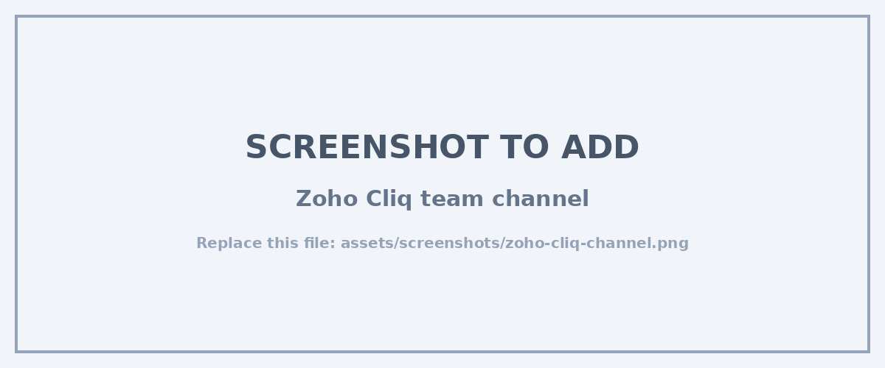
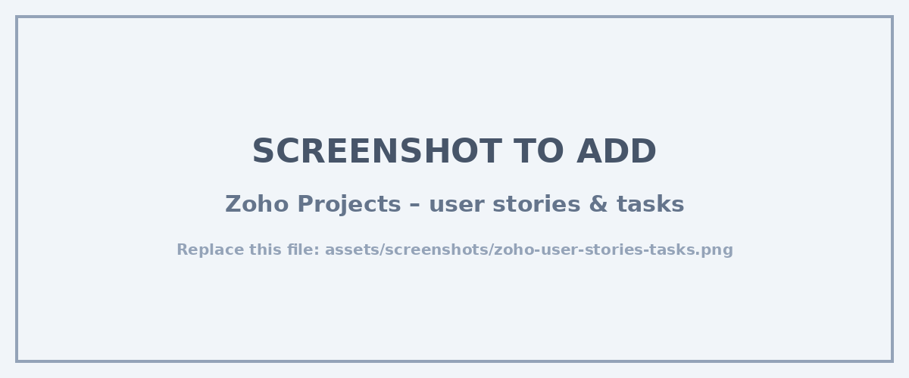
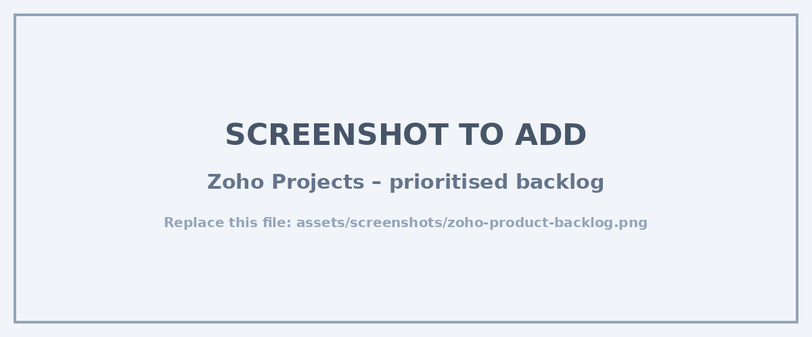
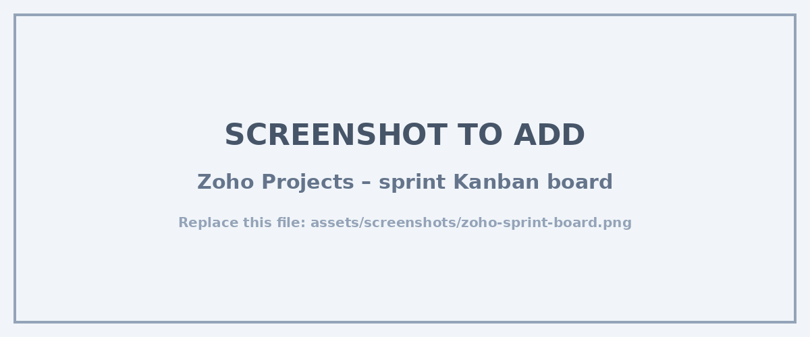
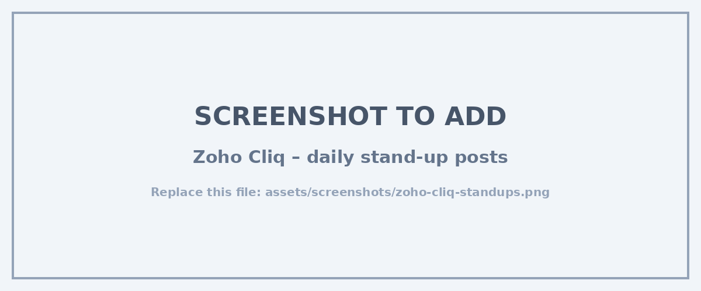

# David Daniel Sepkitt – Professional Portfolio

**Diploma in ICT: Applications Development · Cape Peninsula University of Technology (CPUT)**
**PRP370S – Project Presentation 3 · Digital Portfolio of Evidence (Semester 1 & Semester 2)**

| | |
|---|---|
| **Email** | 240046935@mycput.ac.za |
| **Location** | Cape Town, South Africa |
| **GitHub** | [github.com/DavidDanielx72](https://github.com/DavidDanielx72) |
| **LinkedIn** | [linkedin.com/in/david-sepkitt-811837362](https://www.linkedin.com/in/david-sepkitt-811837362/) |
| **Live Portfolio** | [daviddanielx72.github.io](https://daviddanielx72.github.io/) |

---

## Table of Contents

1. [Career Objective](#career-objective)
2. [Education](#education)
3. [Work Experience](#work-experience)
4. [Technical Skills](#technical-skills)
5. [**Semester 1 – Foundational Projects & Career Readiness**](#semester-1-foundational-projects--career-readiness)
   - [Projects](#semester-1-projects)
   - [Mock Interview](#mock-interview)
   - [STAR Reflections](#semester-1-star-method-reflections)
6. [**Semester 2 – Industry Placement Agile Portfolio**](#semester-2-industry-placement-agile-portfolio)
   - [Context & Confidentiality](#context-how-we-work-at-suitable-focus)
   - [1. Agile Team Charter](#1-agile-team-charter)
   - [2. User Stories and Tasks](#2-user-stories-and-tasks)
   - [3. Product Backlog](#3-product-backlog)
   - [4. Sprint Backlog](#4-sprint-backlog)
   - [5. Agile Logbook](#5-agile-logbook)
   - [Portfolio Summary (Connect)](#portfolio-summary-connecting-the-evidence)
7. [Links](#links)

---

## Career Objective

I am a third-year student at CPUT studying towards a Diploma in Information and Communication Technology in Applications Development. I am currently completing my Industry Placement at **Suitable Focus**, a growing digital agency, where I work across workflow automation, web development and frontend integration for client projects.

I have a foundation in Java, JavaScript, HTML, CSS and SQL, and I am gaining hands-on experience with workflow automation, email marketing integrations and data synchronisation using Zapier, Mailchimp/HubSpot, webhooks and custom JavaScript. My goal is to become a well-rounded **Full Stack Developer** who understands both software development and the business processes it automates.

---

## Education

| Institution | Qualification | Period |
|---|---|---|
| Cape Peninsula University of Technology (CPUT) | Diploma in ICT – Applications Development | 2024 – Present |
| Zwaanswyk High School | National Senior Certificate | 2019 – 2023 |

---

## Work Experience

### Automation & Web Development Intern – Suitable Focus
*Current Industry Placement (Work Integrated Learning)*

Suitable Focus is a recently established agency. Because the company is still growing, formal project management systems were not in place from the start, so the team adopted lightweight Agile practices and modern collaboration tools as client work increased. My main project is building the customer automation infrastructure for a consumer-brand client from the ground up (client name withheld – see [Confidentiality](#confidentiality-statement)).

**Key responsibilities:**
- Designing and building automated customer journey workflows for onboarding and engagement
- Setting up email marketing triggers, list segmentation and scheduled campaign flows (Mailchimp/HubSpot)
- Configuring automated customer satisfaction surveys and feedback loops
- Integrating frontend web forms with automation platforms using webhooks, APIs and Zapier
- Writing custom client-side JavaScript for DOM manipulation, dynamic CSS, JSON formatting and async UI states where CMS templates lack flexibility
- Logging and tracking work in Zoho Projects, posting daily updates in Zoho Cliq and joining planning/review sessions on Google Meet

### Rietfontein Ladismith Guest Farm – Website Update
*January 2026 (3 weeks) · Freelance / real client*
- Updated outdated website content (last refreshed in 2016) for 2026
- Improved mobile usability and overall user experience
- Added new images, rewrote content and improved layout structure
- Website: [rietfontein.co.za](https://rietfontein.co.za/)

### Country Road Waterfront – Woolworths Group
*Seasonal Sales Consultant (Dec 2025 – Jan 2026)*
- Assisted customers in the menswear division
- Handled stock replenishment and delivery verification

### Cape Town DHL Stadium
*Casual Bar Attendant / Cashier (Dec 2023 – Feb 2024)*
- Served customers during high-volume events and concerts
- Managed cash-up processes accurately at the end of shifts

---

## Technical Skills

| Area | Skills |
|---|---|
| **Languages** | Java, JavaScript, HTML, CSS, SQL |
| **Frameworks & Platforms** | React, Supabase, WordPress, Java Swing |
| **Automation & Integration** | Zapier, Mailchimp, HubSpot, webhooks, REST APIs, JSON data handling |
| **Agile & Project Management** | Zoho Projects, Zoho Cliq, Google Meet, Scrum, Kanban, user stories, MoSCoW prioritisation, sprint planning, retrospectives |
| **Tools & IDEs** | Git, GitHub, GitHub Pages, IntelliJ IDEA, NetBeans, Visual Studio Code |
| **Practices** | OOP, layered architecture, debugging & testing, Markdown documentation, DOM manipulation |

---
---

# SEMESTER 1: Foundational Projects & Career Readiness

<a id="semester-1-projects"></a>
## Projects

### 1. Rietfontein Guest Farm – Website Front-End Update (Real Client)
*January 2026 · Individual*
🔗 [rietfontein.co.za](https://rietfontein.co.za/)

I updated and improved the front-end of a real-world accommodation website based on the owner's requirements. The site runs on WordPress, and my job was to modernise content that had not been updated since 2016 and make the site easier to use on mobile.

**My role:**
- Gathered the client's requirements and agreed on what to change
- Customised WordPress theme elements and refined the layout
- Updated text, images and page structure (home, accommodation, hot tubs, activities)
- Improved mobile responsiveness and visual presentation
- Checked pages on different screen sizes before handing over

**Technologies:** WordPress · HTML · CSS · Web design principles

**Evidence:**

<table>
  <tr>
    <td align="center"><br/><sub>Updated home page header and navigation</sub></td>
    <td align="center"><br/><sub>Rewritten content with sidebar and subscription</sub></td>
  </tr>
  <tr>
    <td colspan="2" align="center"><br/><sub>New feature page with updated banner imagery</sub></td>
  </tr>
</table>

---

### 2. Catering Business Website (Group Project – Real Client)
*2026 – Present*
- Full-stack web application built for a real catering client
- **Frontend:** React · **Backend & database:** Supabase
- Team collaboration on design, component development and database structure
- Work managed through GitHub with shared repositories and branches

---

### 3. Student Community App
*2025 · Java (NetBeans)*
- Java-based desktop/mobile-style application aimed at students
- Features: notifications, a student marketplace and chat functionality
- Built with Java Swing GUI components and OOP principles

---

### 4. Payroll Application
🔗 [github.com/DavidDanielx72/PayrollApplication](https://github.com/DavidDanielx72/PayrollApplication)

A Java payroll system that replaces a manual process for a company (STARTUP) with more than 2 000 employees, improving efficiency and providing better HR insights.

**The system manages:**
- Employee details (employee number, name, employment type, nationality)
- Contact details (cell phone, email, home number) and address details
- Identity types (e.g. passport) and job positions
- Position status (OPEN / CLOSED)

**Architecture:** Presentation layer → Service layer → Repository layer

**Technologies:** Java · OOP · IntelliJ IDEA

---

### 5. Wholesale Management System (Group Project)
🔗 [github.com/DavidDanielx72/ADP_Assignment-02](https://github.com/DavidDanielx72/ADP_Assignment-02)

A backend Java system that helps privately owned wholesale stores manage their operations.

**My role:**
- Developed the `Customer` class
- Ensured a correct package structure across the project
- Created missing test classes
- Assisted with debugging and integrating team members' code so the system ran as a whole

**Technologies:** Java · OOP · IntelliJ IDEA · GitHub collaboration

---

### 6. GitHub CV & Portfolio Website
🔗 [daviddanielx72.github.io](https://daviddanielx72.github.io/)

- Personal portfolio and CV hosted on GitHub Pages
- Started as an HTML/CSS/JavaScript site; now maintained as a Markdown portfolio so it is easier to keep up to date
- Contains my CV, projects, mock interview and reflections

**Technologies:** HTML · CSS · JavaScript · Markdown · GitHub Pages

---

<a id="mock-interview"></a>
## Mock Interview

As part of work-readiness training I completed and recorded a mock interview.

🎥 **[Watch my mock interview on YouTube](https://www.youtube.com/watch?v=ZQn11TBY3bs)**

---

## Semester 1 STAR Method Reflections

### 📌 Markdown Coding Reflection

**Situation:** I was required to build my GitHub portfolio using Markdown for my assessment.

**Task:** I needed to present my work, projects and reflections clearly and professionally in a format that renders well on GitHub and GitHub Pages.

**Action:** I learned Markdown syntax – headings, links, lists, tables, images and anchors – and applied a consistent structure across my repositories. I added a table of contents and organised content from general (about me) to specific (projects and evidence).

**Result:** I produced a well-structured portfolio that is easy to read and navigate. The skill has carried into my internship, where I now write technical notes and handover documentation in a similar structured way.

---

### 🎥 Mock Interview Reflection

**Situation:** I took part in a mock interview as part of CPUT's work-readiness training.

**Task:** I had to answer common interview questions professionally and confidently and present my technical experience.

**Action:** I prepared answers using the STAR method, chose concrete project examples (the Payroll Application and the Rietfontein website), and recorded myself so I could review my body language, pace and eye contact.

**Result:** My confidence and communication improved noticeably. I learned to explain technical work in plain language – which helped me during my placement interview at Suitable Focus.

---

### 🌐 GitHub Pages Reflection

**Situation:** I needed to publish my portfolio online so lecturers and employers could access it.

**Task:** I had to deploy the portfolio using GitHub Pages.

**Action:** I created the `username.github.io` repository, configured the Pages settings to deploy from the main branch, and tested every link and relative image path after each change.

**Result:** I successfully published a live portfolio. I now understand how static hosting works, and I update the site regularly – including restructuring it this semester to hold my Agile evidence.

---
---

# SEMESTER 2: Industry Placement Agile Portfolio

> **Scope:** This section covers my **Industry Placement** only (current projects at the company), as required for PRP370S Assessment 2. Each Agile artefact has an **Evidence** part and a **Reflection** part structured with the e-portfolio cycle **Collect → Select → Reflect → Connect**.

## Context: How We Work at Suitable Focus

Suitable Focus is a young agency that did not have formal project management infrastructure from day one. As client work grew, the team adopted Agile practices (short sprints, a shared backlog, daily stand-ups and retrospectives) and introduced tools to stay organised:

| Tool | How we use it | Agile purpose |
|---|---|---|
| **Zoho Projects** | Central hub for tasks, milestones, task lists and the Kanban board (To Do → In Progress → Review/Testing → Done) | Product backlog, sprint backlog, task tracking |
| **Zoho Cliq** | Daily written stand-ups, quick questions, blocker escalation | Daily stand-up, logbook source |
| **Google Meet** | Sprint planning, client syncs, sprint reviews and retrospectives | Sprint ceremonies |
| **Group chat** *(added mid-project)* | Real-time approvals between the dev team, CEO and the client account lead | Removing communication blockers |

> **Note on tools:** The assessment brief uses Trello as an example of a Kanban tool. Suitable Focus does not use Trello – the company recently adopted **Zoho Projects**, which provides the same Kanban board, task list and status workflow. All my evidence therefore comes from Zoho Projects and Zoho Cliq.

### The Project: Client Automation & Web Integration ("Project Launchpad")

My current project is for a new consumer-brand client of Suitable Focus. I refer to it as **Project Launchpad**. We are building their digital automation infrastructure from scratch.

**Goal:** Streamline customer engagement by automating onboarding and email journeys and connecting the client's web capture points (forms and surveys) to the marketing and data platforms.


*Figure 1 – Anonymised architecture of the automation journeys I built (diagram created by me).*

**Project status at time of submission:**

| ✅ Completed | 🔄 In progress / still to do |
|---|---|
| Workflow & journey architecture mapped and configured | Advanced, behaviour-based segmentation |
| Email triggers, list segmentation and campaign sequences | Performance tracking dashboards |
| Custom JavaScript for DOM manipulation, dynamic CSS, JSON formatting and async UI states on survey pages | Full end-to-end testing across devices and form inputs |
| Form integrations syncing web entry points with the automation platform | Technical documentation and formal client handover via Zoho Projects |

### Confidentiality Statement

This portfolio is shared publicly, so I have protected the client and my host company:
- The client's **name, brand, website URLs and staff names are withheld**
- **No customer data, email addresses, API keys, account IDs or credentials** appear anywhere
- **No commercial information** (pricing, contract terms, internal performance figures) is included
- Screenshots from Zoho Projects / Zoho Cliq have **names, client details and message content blurred**
- Diagrams marked *"created by me"* are my own visual summaries of our process, used where a raw screenshot would expose confidential information

---

## 1. Agile Team Charter

### Evidence

Because Suitable Focus is a startup, there was no inherited charter. The team agreed its working agreements at project kick-off and – importantly – **changed them during the project** when a problem appeared. The charter below is the current version (v2).


*Figure 2 – Team charter canvas for the client automation team (created by me from our agreed working practices).*

**Summary of the charter:**

| Element | Our agreement |
|---|---|
| **Shared purpose** | Deliver reliable automation journeys and frontend integrations that help our client launch, onboard and keep customers – tested, documented and handed over cleanly. |
| **Core values** | Transparency · Ownership · Quality before speed on live data · Respect for timelines · Client confidentiality |
| **Roles** | CEO = product owner (priorities & sign-off) · Account lead = client liaison · Me = automation build, JS/frontend integration, testing · Team member = forms, UI fixes, reviews |
| **Working agreements** | Daily stand-up in Zoho Cliq by 09:30 · Blockers posted within 24 h · Every task logged in Zoho Projects before work starts · Weekly planning/review on Google Meet |
| **Operational boundaries** | Automation changes tested in staging first · Live-page JavaScript changes need a second review · New requests discussed before entering the backlog · No client data or credentials outside approved tools |
| **Definition of Done** | Acceptance criteria met · Tested with sample data incl. edge cases · Reviewed by a second person · Moved to Done in Zoho Projects · Handover note written |

#### Charter change log (a living document)

| Version | Trigger | Change |
|---|---|---|
| v1 – Kick-off | Project start | Agreed tools (Zoho Projects, Cliq, Meet), stand-up time, staging-first rule, Definition of Done |
| v2 – Sprint 2 | Approvals from the client side took days over email, stalling sprint tasks | Added a **dedicated real-time group chat** (dev team + CEO + account lead) for clarifications and approvals; agreed that every decision made in chat is **copied into the related Zoho Projects task** so there is still a record |


*Figure 3 – Charter update v2: moving approvals from slow email threads to a real-time group chat.*

**Screenshot evidence (names and content blurred):**


*Figure 4 – Our Zoho Cliq channel where the working agreements are pinned and daily stand-ups are posted.*

### Reflection

**Collect:**
In my first weeks I collected observations about how the team actually worked: where tasks got lost, how long questions took to answer and which tools people used. I noticed that requests discussed in conversation were often never written down, and later on I saw that sign-offs from the client side could take several days over email. I gathered this from my own waiting time on tasks, from stand-up messages and from planning discussions.

**Select:**
From these observations I selected the agreements that addressed the biggest gaps. Logging every task in Zoho Projects solved "lost" work. Posting blockers in Zoho Cliq within 24 hours meant we stopped waiting for weekly meetings. The most important item I selected as evidence is the **v2 change** – the group chat – because it shows the charter being used as a tool to fix a real problem rather than a document that was written once and forgotten.

**Reflect:**
The communication bottleneck taught me that a process can be technically correct but still fail if the feedback loop is too slow. Our automation sequences were ready, but they could not go live without approval, so the sprint stalled. When the team created the group chat with the CEO and the account lead, decisions that used to take days took hours. I also learned the downside of chat – decisions can disappear in the scroll – which is why we added the rule to copy decisions into Zoho Projects. Personally, I learned to raise a blocker early and clearly instead of waiting politely, and to keep my messages specific ("Please approve email 2 of the welcome sequence – preview attached") so they are quick to answer.

**Connect:**
The charter is the foundation for every other artefact in this portfolio. The Definition of Done shapes how I write acceptance criteria for **user stories**, the "discuss before adding" rule controls what enters the **product backlog**, the stand-up agreement produces my **logbook** entries, and the v2 change came directly out of a **sprint retrospective**. It also connects to my Semester 1 group projects, where we had no agreed way of working – I now understand why that caused confusion and I would start any future team project with a short charter.

---

## 2. User Stories and Tasks

### Evidence

Client requests are turned into user stories in planning sessions on Google Meet with my supervisor. Each story follows the format **"As a [user], I want [goal] so that [benefit]"**, gets **acceptance criteria** (Given/When/Then), a **story point** estimate and is then broken down into tasks in Zoho Projects.


*Figure 5 – User story map: epics → stories → tasks (created by me).*

#### US-01 · Automated customer onboarding journey · Epic: Onboarding · 5 pts · Must Have
> *As a **new customer**, I want to **receive a welcome email with clear next steps immediately after signing up** so that **I know how to engage with the brand**.*

**Acceptance criteria**
- **Given** a visitor submits the sign-up form, **when** the webhook fires, **then** a contact is created/updated in the email platform with the correct tags
- **Given** the contact is created, **when** 5 minutes have passed, **then** the welcome email is sent exactly once
- **Given** a date field is submitted, **then** it is stored in the platform's required format

**Tasks**

| # | Task | Estimate | Status |
|---|---|---|---|
| 1 | Set up webhook to receive form submission data | 2 h | ✅ Done |
| 2 | Map form fields to list, tags and segments | 3 h | ✅ Done |
| 3 | Write JavaScript transform to fix date format in payload | 1 h | ✅ Done |
| 4 | Configure welcome email trigger with 5-minute delay | 2 h | 🔍 Review |
| 5 | Test with sample submissions (valid, missing fields, duplicates) | 3 h | 🔍 Review |
| 6 | Deploy to live and monitor delivery for one week | 1 h | ⬜ To Do |

#### US-02 · Post-interaction feedback survey · Epic: Feedback · 5 pts · Should Have
> *As a **customer**, I want to **receive a short satisfaction survey after my interaction** so that **I can share feedback easily**.*

**Acceptance criteria**
- Survey is sent **24 hours** after the interaction is recorded
- Required fields cannot be submitted empty and show a clear error message
- Each response updates the correct contact record

**Tasks:** Design survey form and required fields → Connect survey to automation via webhook → Configure 24 h trigger → Test data sync → Deploy and verify records update.

#### US-03 · Survey and landing pages display as designed · Epic: Frontend · 8 pts · Must Have
> *As a **site visitor**, I want the **survey and landing pages to display correctly on any device** so that **the experience matches the brand's design, even where the template is limited**.*

**Acceptance criteria**
- Layout matches the design on Chrome, Edge, Safari and mobile
- Data loading shows a loading state; failed requests show a friendly error state
- No console errors on page load

**Tasks:** Identify where the CMS template cannot render the layout → Write JavaScript to manipulate the DOM → Inject dynamic CSS rules → Format incoming JSON payloads and handle async UI states → Cross-browser/device testing → Second review → Deploy.

#### More stories in the backlog

| ID | User story | Points |
|---|---|---|
| US-04 | As the **marketing team**, I want contacts **segmented by source and behaviour** so that each customer receives relevant campaigns. | 8 |
| US-05 | As the **project team**, I want **end-to-end tests of every journey** across devices and inputs so that nothing fails after launch. | 5 |
| US-06 | As the **client**, I want a **performance dashboard** (opens, clicks, survey responses) so that I can see what is working. | 8 |
| US-07 | As the **client**, I want **technical documentation and a handover session** so that my team can maintain the automations. | 3 |

**Code evidence (sanitised):** a simplified version of the type of JavaScript I wrote for US-01 and US-03. Field names and selectors are generic.

```javascript
// US-01: normalise a date coming through the webhook (DD/MM/YYYY -> YYYY-MM-DD)
function normaliseDate(value) {
  const [day, month, year] = value.split('/');
  return `${year}-${month.padStart(2, '0')}-${day.padStart(2, '0')}`;
}

// US-03: inject layout rules the template cannot provide and handle async states
function enhanceSurveyPage() {
  const style = document.createElement('style');
  style.textContent = '.survey-grid{display:grid;gap:1rem} @media(max-width:600px){.survey-grid{grid-template-columns:1fr}}';
  document.head.appendChild(style);
  document.querySelector('.survey-form')?.classList.add('survey-grid');
}

async function loadSurveyData(url, container) {
  container.textContent = 'Loading...';            // loading state
  try {
    const res = await fetch(url);
    if (!res.ok) throw new Error(res.status);
    const data = await res.json();                 // format JSON payload
    container.innerHTML = data.questions.map(q => `<label>${q.label}</label>`).join('');
  } catch (err) {
    container.textContent = 'Something went wrong. Please refresh the page.'; // error state
  }
}
```

**Screenshot evidence (names and content blurred):**


*Figure 6 – User stories broken into tasks in Zoho Projects.*

### Reflection

**Collect:**
I collected the client's requests as they arrived – mostly short, broad phrases such as "automated customer journeys" or "make the survey page look right" – together with notes from planning calls and the problems I hit while building.

**Select:**
I selected the three stories above as my main evidence because they cover the three types of work I do: automation (US-01), data capture (US-02) and frontend coding (US-03). US-03 is the best example of why decomposition matters: "make the page look right" is a wish, not a task. Breaking it into DOM manipulation, CSS injection, JSON formatting and async states gave me a clear order of work and something testable at each step.

**Reflect:**
Writing stories from the customer's point of view changed how I think. Before, I would start with the tool ("set up a Zap"). Now I start with who benefits and what "done" looks like. Adding acceptance criteria was the biggest improvement: my first welcome-email trigger "worked" but fired with a 0-second delay; once "sent after 5 minutes, exactly once" was written as a criterion, the bug was obvious during testing. Estimating in story points was hard at first – I under-estimated testing time – so I now add explicit testing tasks to every story.

**Connect:**
User stories are the units that fill the **product backlog** and are pulled into the **sprint backlog**; their tasks are what I report on in my **logbook**; and the acceptance criteria apply the **Definition of Done** from the team charter. This links back to Semester 1, where my Payroll and Wholesale projects were specified as features ("create Customer class"). Thinking in user stories would have made those projects more user-focused, and I will use this approach in all future projects.

---

## 3. Product Backlog

### Evidence

The product backlog lives in Zoho Projects and holds all known work for the project – features, bugs, improvements and technical tasks. The CEO (product owner) and the team rank it during planning on Google Meet using **MoSCoW** and three questions: *client impact*, *urgency/dependencies* and *effort*.


*Figure 7 – Product backlog grouped by MoSCoW priority (visual summary created by me).*

| Rank | ID | Backlog item | Type | Priority | Points | Status |
|---|---|---|---|---|---|---|
| 1 | US-01 | Onboarding automation journey | Feature | Must Have | 5 | 🔄 In sprint |
| 2 | BUG-01 | Survey form required-field validation | Bug | Must Have | 2 | 🔄 In sprint |
| 3 | US-03 | Survey/landing page JavaScript fixes | Frontend | Must Have | 8 | 🔄 In sprint |
| 4 | US-05 | End-to-end testing of all journeys | Testing | Must Have | 5 | 🔄 In sprint |
| 5 | US-02 | Post-interaction feedback survey | Feature | Should Have | 5 | ✅ Built, awaiting E2E test |
| 6 | US-04 | Behaviour-based segmentation & campaign flows | Feature | Should Have | 8 | 🔄 Partially done |
| 7 | UI-01 | Mobile layout for survey portal | UI | Should Have | 2 | 🔄 In sprint |
| 8 | US-07 | Technical documentation & client handover | Docs | Should Have | 3 | ⬜ Next sprint |
| 9 | US-06 | Performance tracking dashboard | Analytics | Could Have | 8 | ⬜ Next sprint |
| 10 | ENH-01 | CSV export of survey responses | Enhancement | Could Have | 2 | ⬜ Backlog |
| 11 | TD-01 | Rebuild internal legacy workflow engine | Tech debt | Won't Have (now) | – | ⏸ Parked |

**Backlog refinement rules we follow:**
- New requests (from the client or the group chat) are written as user stories and discussed before being ranked – they never jump straight into the current sprint
- Items at the top of the backlog must be "ready": clear story, acceptance criteria and an estimate
- The backlog is re-ranked at every sprint planning session

**Screenshot evidence (names and content blurred):**


*Figure 8 – Prioritised backlog / task list in Zoho Projects.*

### Reflection

**Collect:**
I collected every request, bug and idea in one place – the Zoho Projects task list – instead of leaving them scattered across emails, chat messages and my notebook. This alone revealed how much work the project really contained.

**Select:**
I selected MoSCoW as the prioritisation method because it is simple for a non-technical client and CEO to understand. The key decision I want to highlight is **ranking end-to-end testing (US-05) as a Must Have** alongside launch features – after our trigger bug in Sprint 1, the team agreed that an untested automation is a risk to real customers, not a finished feature.

**Reflect:**
Managing a backlog in a startup taught me that there are always more tasks than hours, and that saying "not now" is a valid decision. Moving the legacy engine rebuild to "Won't Have (now)" felt uncomfortable at first, but it protected the client's launch. I also learned that a backlog is only useful if it is honest – items that are "almost done" stay open until they meet the Definition of Done. When my supervisor asks what I am working on, I can point to the top of the backlog and explain *why* it is there.

**Connect:**
The product backlog is the link between the client's goals and our day-to-day work: **user stories** go in, the **sprint backlog** is pulled from the top, and the **retrospectives** in my logbook change how it is ranked. It also shows my growth since Semester 1 – in the Catering Website group project we worked through features in whatever order they came up; a ranked backlog would have helped us deliver the most important features first.

---

## 4. Sprint Backlog

### Evidence

We work in **two-week sprints**. At sprint planning (Google Meet) we agree a **sprint goal**, check capacity and pull the highest-ranked "ready" items from the product backlog. Progress is tracked daily on the Zoho Projects Kanban board.

| Sprint | Sprint goal | Outcome |
|---|---|---|
| Sprint 1 | Onboarding journey working in staging | ✅ Met – but trigger delay bug found late (see logbook) |
| Sprint 2 | Survey journey + survey page JavaScript | ⚠️ Partly met – client approvals delayed; charter v2 introduced |
| **Sprint 3 (current)** | **Onboarding and feedback journeys tested end-to-end; survey pages render correctly on mobile** | 🔄 In progress |
| Sprint 4 (planned) | Segmentation analytics, dashboards, documentation and client handover | ⬜ Planned |


*Figure 9 – Sprint 3 board showing tasks across To Do, In Progress, Review/Testing and Done (diagram mirrors our Zoho Projects board).*

**Sprint 3 backlog**

| Task | Story | Owner | Points | Status |
|---|---|---|---|---|
| Webhook → field mapping → tags | US-01 | Me | 3 | ✅ Done |
| Date-format JavaScript transform in payload | US-01 | Me | 1 | ✅ Done |
| Investigate survey validation bug | BUG-01 | Team member | 1 | ✅ Done |
| Welcome trigger (5-min delay) tested in staging | US-01 | Me → reviewer | 2 | 🔍 Review/Testing |
| JavaScript async loading/error states on survey page | US-03 | Me | 3 | 🔄 In Progress |
| Fix survey required-field validation | BUG-01 | Team member | 2 | 🔄 In Progress |
| Cross-device test of survey pages | US-05 | Me | 3 | ⬜ To Do |
| Behaviour-based segment triggers | US-04 | Me | 5 | ⬜ To Do |
| Mobile CSS for survey portal | UI-01 | Team member | 2 | ⬜ To Do |
| **Total committed** | | | **22** | **5 pts done · 2 in review · 15 remaining** |

**Screenshot evidence (names and content blurred):**


*Figure 10 – Live Kanban board in Zoho Projects for the current sprint.*

### Reflection

**Collect:**
I collected the sprint plans, the board status at the start and end of each sprint and the notes from our review meetings. Comparing what we planned with what we finished showed a pattern: we usually finished building on time but not testing.

**Select:**
I selected Sprint 3 as my main evidence because it is the sprint where we applied the lessons from Sprints 1 and 2 – it has a clear, testable sprint goal, testing tasks are planned as their own cards, and there is a **Review/Testing** column so nothing moves straight from "In Progress" to "Done".

**Reflect:**
The sprint backlog makes a large project feel manageable: instead of looking at everything needed for launch, I focus on this sprint's goal. Sprint 2 taught me that a sprint can fail for reasons outside the code – our tasks were ready but waiting for approval. Making that visible on the board ("Waiting for feedback") is what convinced the team to change our communication channel. I have also improved my estimating: I now include testing time in my points, and our commitment for Sprint 3 is smaller but more realistic.

**Connect:**
The sprint backlog turns the **product backlog** into daily action, the **team charter** defines when a card may move to Done, and each day's movement on the board is recorded in my **logbook**. Compared with Semester 1, where deadlines were the only checkpoints, working in sprints gives a short feedback loop every two weeks, which I would use for my own projects going forward.

---

## 5. Agile Logbook

### Evidence

I keep a logbook that combines my daily stand-up posts in Zoho Cliq (*Yesterday / Today / Blockers*), my own technical notes and our sprint retrospectives. Below are excerpts covering the full project so far.

#### Sprint 1 – Week 1 (daily log)

| Day | Stand-up / work done | Blockers | Hours |
|---|---|---|---|
| Mon | Planned onboarding journey; read email platform and webhook documentation. | API access not yet received | 6 |
| Tue | Received access; created webhook and ran first connection test – successful. | None | 8 |
| Wed | Mapped form fields to list and tags. Dates arrived in the wrong format – wrote a small JavaScript transform to fix them. | Need a live form submission to test | 7 |
| Thu | Tested welcome trigger – emails not sending as expected. Found the trigger delay set to 0 seconds; changed to 5 minutes. | Resolved same day | 8 |
| Fri | Onboarding journey deployed to staging and review requested. Started survey page JavaScript investigation. | Waiting for review before going live | 6 |

**Sprint 1 retrospective**
- 👍 **Went well:** Onboarding journey works correctly in staging; blockers raised quickly in Zoho Cliq
- 👎 **To improve:** Trigger conditions tested too late – the delay bug should have been caught earlier
- 🎯 **Action:** Add explicit testing tasks to every automation story; no card moves to Done without a test note

#### Sprint 2 – weekly summary

| Week | Work done | Blockers | Hours |
|---|---|---|---|
| Week 3 | Built survey journey (24 h trigger, webhook to records). Wrote JavaScript to inject CSS and restructure the survey page DOM where the template could not. | Copy and sequence approval from the client side pending over email | 36 |
| Week 4 | Formatted incoming JSON for the survey page; added async UI updates. Several tasks moved to "Waiting for feedback". | Approvals delayed several days → raised in retro | 34 |

**Sprint 2 retrospective**
- 👍 **Went well:** Survey journey and page enhancements built on time
- 👎 **To improve:** Email approvals created a bottleneck; sprint goal only partly met
- 🎯 **Action:** Create a dedicated group chat (dev team, CEO, account lead) for approvals and copy decisions into Zoho Projects → **team charter updated to v2**

#### Sprint 3 – current (weekly summary)

| Week | Work done | Blockers | Hours |
|---|---|---|---|
| Week 5 | Approvals received within hours via group chat; welcome sequence approved. Added loading and error states to survey page JavaScript. Welcome trigger moved to Review/Testing. | None | 38 |
| Week 6 | Planned end-to-end test cases (valid input, missing fields, duplicate sign-ups, mobile/desktop). Started behaviour-based segment rules. | Test data needed for segmentation – requested in stand-up | – |

#### Personal technical notes (lessons I re-use)
- **Always check trigger delays and conditions first** when an automation "does not send"
- **Normalise dates before they reach the platform** – the same transform fixed a second form later
- **Test async UI in three states:** loading, success and error
- **Copy every chat decision into the Zoho Projects task** so there is one source of truth

**Screenshot evidence (names and content blurred):**


*Figure 11 – Daily stand-up updates posted in Zoho Cliq.*

### Reflection

**Collect:**
Every day I collected the same three facts – what I did, what I will do next and what is blocking me – and posted them in Zoho Cliq. I added technical notes whenever I solved a problem and recorded the outcome of each retrospective.

**Select:**
I selected entries that show a story of improvement rather than a list of hours: the trigger delay bug in Sprint 1, the communication bottleneck in Sprint 2 and the faster approvals in Sprint 3. Each one led to a concrete action that changed how the team works.

**Reflect:**
Keeping a logbook made me honest about the difference between what I planned and what I actually finished. Looking back, I see clear patterns: I under-estimated testing, I work best on complex JavaScript in the morning, and blockers that feel huge often disappear within an hour once I communicate them clearly. The logbook also made retrospectives more useful – instead of relying on memory, I could point to the exact day and cause of a problem. My technical notes have already saved time: when a second form had the same date issue, I re-used the transform instead of debugging from scratch.

**Connect:**
The logbook ties all the other artefacts together: it records progress on **user stories** and **sprint backlog** tasks, its blockers feed into **backlog** re-prioritisation, and its retrospectives produced the **team charter** update. It also continues the reflective habit I started with the STAR reflections in Semester 1 – but now I reflect continuously during the work, not only at the end.

---

## Portfolio Summary: Connecting the Evidence

```
 Team Charter ──► how we work (values, DoD, channels)
      │                         ▲
      ▼                         │ retrospective actions (e.g. charter v2)
 User Stories ──► Product Backlog ──► Sprint Backlog ──► Daily work ──► Agile Logbook
 (what users need)  (ranked by MoSCoW)  (2-week goal)     (Zoho board)   (stand-ups, retros)
```

**Semester 1** gave me the technical foundation (Java, OOP, web development, GitHub) and career-readiness skills (CV, mock interview, documentation). **Semester 2** showed me how that technical work fits into a real team process. The biggest lessons from my placement are:

1. **Process is a tool, not paperwork** – the charter, backlog and board each solved a real problem we had.
2. **Communication is part of delivery** – the fastest code in the world still waits for an approval; fixing the channel unblocked the sprint.
3. **"Done" means tested** – automations affect real customers, so testing is a Must Have, not an afterthought.
4. **Small, honest feedback loops** (daily stand-ups, two-week sprints, retrospectives) help a new developer improve quickly.

**Next steps for the project:** complete end-to-end testing, finish behaviour-based segmentation and dashboards, write the technical documentation and run the formal handover with the client through Zoho Projects.

---

## Links

- **GitHub Profile:** [github.com/DavidDanielx72](https://github.com/DavidDanielx72)
- **Live Portfolio Website:** [daviddanielx72.github.io](https://daviddanielx72.github.io/)
- **GitHub Pages Repository:** [DavidDanielx72.github.io](https://github.com/DavidDanielx72/DavidDanielx72.github.io)
- **Semester 1 Portfolio Repository:** [DavidDaniel-Portfolio](https://github.com/DavidDanielx72/DavidDaniel-Portfolio)
- **Payroll Application:** [PayrollApplication](https://github.com/DavidDanielx72/PayrollApplication)
- **Wholesale Management System:** [ADP_Assignment-02](https://github.com/DavidDanielx72/ADP_Assignment-02)
- **LinkedIn:** [david-sepkitt-811837362](https://www.linkedin.com/in/david-sepkitt-811837362/)

---

*References: Agile definitions follow the PRP370S Assessment 2 brief (CPUT, 2026). All diagrams marked "created by me" were produced by the author. Client information has been withheld for confidentiality.*
